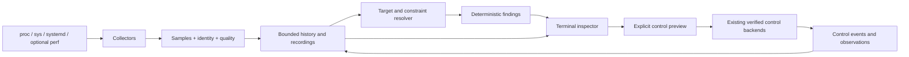

# Resource Lens improvement blueprint

Status: implementation plan; only milestones explicitly marked complete describe delivered work.
Prepared: 2026-10-27. Baseline: version 0.16.1.

Implementation progress: **M0–M4 implemented**. M0/M1 completed on 2026-10-27;
M2/M3 implemented on 2026-10-30. See
[M0 baseline and verification](M0_BASELINE.md), [data contracts](DATA_CONTRACTS.md),
and [benchmark instructions](BENCHMARKING.md). [M1 validation](M1_VALIDATION.md)
records target resolution and source-aware collection. [M2 validation](M2_VALIDATION.md)
records the unified inspector, initial findings and capture workflow.
[M3 validation](M3_VALIDATION.md) records connected controls, guarded restoration
and time-aware observation. [M4 validation](M4_VALIDATION.md) records saved sessions,
offline replay, comparisons and broader findings (2026-11-02). M5 PR14 memory
observation/MemoryHigh is implemented; [PR14 validation](M5_MEMORYHIGH_VALIDATION.md)
records fixture and terminal evidence. M5 PR15 MemoryMax remains deferred. Live
enforcement and independent usability remain explicit validation gaps.

This is the current forward plan. [ROADMAP.md](ROADMAP.md) and
[FEATURE_PLAN.md](FEATURE_PLAN.md) retain historical release plans. Delivered
behavior belongs in [USER_GUIDE.md](USER_GUIDE.md); verified results belong in
[VALIDATION.md](VALIDATION.md).

Reading paths:

- Product/workflows: [goal](#1-product-goal-and-scope) and
  [user experience](#3-intended-user-experience).
- Engineering: [contracts](#4-architecture-and-contracts),
  [collection/findings](#5-collection-and-interpretation-work),
  [controls](#6-control-experience-and-lifecycle), and
  [sessions](#7-evidence-sessions-and-comparisons).
- Execution: [delivery backlog](#9-delivery-milestones-and-implementation-backlog)
  and [release gates](#10-verification-and-release-gates).

## 1. Product goal and scope

Resource Lens should help a developer or technically curious user answer:

1. What resources exist, and which processes or groups are using them?
2. What is this workload doing: executing, waiting, reclaiming memory, or being limited?
3. Which settings and ancestor constraints affect it, and who owns those settings?
4. What can I change, what else will that affect, and can I restore the setting?
5. What happened before and after a change or incident, and what evidence can I save?

The central workflow is **Explore → Select → Understand → Investigate or Adjust → Compare**.
Ordinary monitoring remains useful even when there is no performance problem.
The same inspector should support starting from a process, service, CPU, disk,
interface, or recorded incident.

### Planning decisions

- Keep Linux, the terminal/SSH experience, Python 3.10+, and the standard-library
  runtime as the initial platform. Keep perf and driver tools optional.
- Evolve the existing application incrementally. Preserve working collectors,
  control backends, profiling, recordings, and terminal behavior.
- Prioritize CPU, memory, and disk explanations before adding control families.
- Use deterministic, evidence-backed findings. An LLM, remote account, database,
  background privileged daemon, or network service is not required.
- Preserve read-only startup. Control mode reveals actions; each mutation still
  requires its own concrete preview and explicit Apply.
- Treat monitoring, interpretation, configuration verification, and observed
  enforcement as distinct results. A confirmed setting does not prove an improved
  application outcome.
- Retain current shortcuts during migration. New actions first appear as named,
  searchable commands and buttons; do not allocate more global letters casually.

### Outside the first delivery

Fleet management, a web rewrite, Windows/macOS support, automatic tuning, general
shell execution, application-specific latency instrumentation, unrestricted cgroup
editing, persistent system configuration, network shaping, and GPU tuning are
separate projects. Existing hardware controls remain available in advanced views.

## 2. Audited starting point

The source review ran all 247 tests successfully and obtained a live JSON sample.
It did not exercise live resource mutations or validate new hardware. One sample
took approximately 863 ms wall time and 75 ms collector-thread CPU time with
three visible processes. This is an environment-specific observation, not a
benchmark or evidence that process enumeration caused the delay.

| Area | Existing implementation | Improvement needed |
| --- | --- | --- |
| Sampling | `collect.py`, `workloads.py`, `hardware.py`, `energy.py`, `resource_topology.py` | Stage timing, freshness by source, explicit read failures, cadence separation |
| Navigation | `ui.py`, `navigation.py`, `application_processes.py`, `cgroup_browser.py`, `workspaces.py` | One target context and consistent routes between a process, its exact cgroup, its service, and devices |
| Explanation | `insights.py`, `resource_panels.py`, `impact.py` | Target-specific findings that connect readings, constraints, and next actions |
| Controls | `controls.py`, `placement.py`, `disk_controls.py`, `hardware.py`, `helper.py` | Shared presentation/lifecycle and direct navigation from the inspected target |
| Debugging | `profiling.py`, `scheduler_trace.py`, `memory_sharing.py` | Persistent investigation context, capture choices, saved evidence navigation |
| History | `investigation.py`, `recording.py`, `incidents.py`, `usability.py` | Session browser, time-aware comparisons, coverage and provenance |
| Quality | Unit fixtures, PTY checks, dedicated enforcement scripts | Cross-feature scenarios, performance baselines, independent usability and broader live coverage |

Important source-level constraints:

- `WorkloadCollector.sample()` groups by the nearest service/scope. A process may
  reside in a deeper child cgroup with additional constraints. Service attribution
  must not replace exact membership when explaining a selected process.
- `WorkloadCollector.limits()` stops before the visible cgroup mount root. A new
  resolver must distinguish the true hierarchy root, a namespaced or bind-mounted
  subtree root, and inaccessible ancestry. Visibility is not proof of no limits.
- Most live cgroup detail is collected for groups discovered through processes.
  The hierarchy browser has a separate, bounded, lightweight scan. Detailed
  inspection must also work for a selected ancestor or otherwise visible group.
- Basic file reads often turn errors into empty strings. Measurement health
  cannot reliably explain all missing readings with the current data contract.
- The UI has ten pages and a large `View` composed from eight mixins. State,
  actions, drawing, and modal routing are closely coupled.
- Timeline averages are sample-weighted; the UI reports this limitation. Saved
  profile comparison is already available through the CLI and should be reused.
- Direct Undo is session-local. The helper has its own server-side receipts;
  saved recordings are not authorization to replay mutations.

## 3. Intended user experience

### A. Explore the machine

Overview keeps its resource cards and topology. Each card answers three questions:
current usage, evidence of pressure or limits, and available drill-downs. Display
the measurement scope and age without requiring a help page.

Selecting a CPU or disk shows relevant groups using existing evidence. Label CPU
relationships as eligible placement unless execution was actually measured. Show
disk relationships by accounting device, including unknown layered mappings.
Network/GPU cards explain when workload attribution is unavailable.

Do not combine all resources into an unexplained health score. A machine can have
idle CPUs while one workload is restricted, or high usage without a problem.

### B. Understand one workload

Selecting a process opens an inspector with a persistent identity header and
five sections: Summary, Usage, Constraints, Evidence, and Actions.

The Summary begins with plain statements and links to their evidence. Show the
process and enclosing group as different scopes. Users can open the exact cgroup,
nearest service, and limiting ancestor without searching again.

Illustrative layout; values are fictional and do not describe this machine:

```text
worker  PID 4231                  Live · process + group context
Process: 94% CPU (100% = one logical CPU)       RSS: 180 MiB
Group: /system.slice/build.service/jobs        sampled 0.4s ago

Observed: this group's quota-throttling counter increased.
Constraint: jobs has a 100% quota; build.service has a 200% quota.
Scope: group counters include its other processes and descendants.
Meaning: quota restriction was observed; request delay is unmeasured.

[Evidence] [CPU + waits] [Open group] [Review controls]
[Summary] [Usage] [Constraints] [Evidence] [Actions]
```

The fictional child group above need not be directly controllable. Review
controls must show its actual owner and may offer only navigation to the service;
it must not imply that changing the service removes the child's tighter limit.

### C. Investigate a slowdown

1. Select the process or group and review sustained observations over a visible window.
2. Open a finding to see readings, source, time range, scope, limitations, and alternatives.
3. Choose a capture: counters, CPU stacks, CPU + waits, memory inspection, or energy.
4. Explain unavailable capture capabilities and offer a counters-only choice explicitly.
5. Keep the target, findings, and capture result together as an investigation.
6. Save or export evidence, or proceed to a supported control preview.

Show a configurable duration before capture; default to the existing ten seconds.
Escape returns promptly and requests cancellation. Label cancelled/partial output
accurately. On-demand reads and perf startup never run in the input handler.

### D. Change a resource allocation and observe it

The selected process can lead to its owning service's controls, but the user must
see and select that scope explicitly. Every preview shows old/new values, units,
affected group/descendants or hardware, ancestor restrictions, capability status,
setting lifetime, and restoration limitations.

After applying, show the setting verification separately from observed counters.
Offer a before/after observation window and an optional user-supplied workload
result. Keep restoration available from a session-wide Changes list.

### E. Reopen an investigation

A Sessions view lists captures, recordings, and comparison results, with type,
target, date, duration, completeness, and collection quality. Open recorded
evidence without reading the current machine. Compare compatible sessions with
visible coverage and configuration differences.

### Interaction and accessibility requirements

- All primary tasks work with keyboard or mouse, without memorizing a shortcut.
- Search includes entities and named actions. Choosing a mutation action opens a
  preview workflow; typing in search never executes a command or setting change.
- Esc returns one level while retaining selection/filter/scroll context. A modal
  captures input; background controls cannot receive it.
- Preserve PID/start-time selection across sorting and refreshes. Exited or
  replaced targets show a clear state rather than silently selecting a substitute.
- At 120×35, use list/detail panes; at 80×24, stack or switch panes; at 40×12,
  retain readable summaries, scrolling and navigation. Mutation confirmation may
  require a larger terminal when its complete scope cannot be shown.
- Color supplements words and symbols. Keep ASCII rendering and text explanations.
- Unavailable features have a reason and a useful next step. No empty mysterious panel.

## 4. Architecture and contracts

### Direction of dependencies



The findings engine consumes data and returns structured results. It never reads
the live filesystem, invokes systemd, imports curses, or applies controls. A replay
can therefore produce explanations from the same evidence as a live session.

### Proposed modules and responsibilities

These are boundaries to introduce as needed, not a requirement to create all
modules before delivering the first workflow.

| Proposed module | Responsibility | Existing code to adapt |
| --- | --- | --- |
| `model.py` | Small typed identities, quality records, constraints, findings, action references | Shared dictionary contracts |
| `targets.py` | Resolve exact process membership, service association, ancestor chain and visibility | `workloads.py`, `cgroup_browser.py`, `workspaces.py` |
| `sampling.py` | Source scheduling, timings, bounded jobs, publication of samples | Collection loop in `ui.py`, `collect.py` |
| `diagnostics.py` | Pure evidence rules and rule-version metadata | New behavior; reuse metric definitions from `insights.py` |
| `inspector.py` | Target inspector state, rendering and navigation | `application_processes.py`, `cgroup_browser.py`, `workspaces.py` |
| `actions.py` | Named action registry, applicability, help, buttons and dispatch | `navigation.py`, UI key routing |
| `control_workflow.py` | Common preview/result presentation and Changes list | Adapt existing sessions without replacing domain verification |
| `sessions.py` | Bounded discovery and indexing of existing artifact formats | `profiling.py`, `recording.py`, `usability.py` |
| `comparison.py` | Coverage-aware windows and saved-run comparison presentation | `investigation.py`, existing `profiling.compare()` |

Move one interaction or domain at a time. Keep adapter methods on `View` until
callers migrate. Avoid a wholesale UI framework or backend rewrite.

### Identity and scope

Define a `TargetRef` with kind, identity fields, display label, and collection scope.
Labels and PIDs alone are never stable identities.

| Target | Required identity/context |
| --- | --- |
| Process | PID, start ticks, collection/boot scope; PID namespace identity when available |
| Thread | TID, start ticks, owning process identity; explicit single-thread versus thread-set scope |
| Cgroup | Visible path, filesystem/device and inode identity, mount/namespace context; observed lifetime generation |
| Systemd control target | Cgroup identity plus manager, owner UID where applicable, exact unit and fresh InvocationID |
| Device/interface | Existing replacement-aware identity plus collection/boot scope |
| Recording | Recording/session ID and its recorded scope; never implicitly a current live target |

If boot or namespace information is unavailable, preserve a session-local identity
and mark cross-session equivalence unknown. An inode alone is not a permanent
identifier. Invalidate history across observed disappearance/recreation, and keep
fresh backend identity checks for mutations.

Store exact membership and service association separately. Re-read both around
on-demand collection; if membership changes, discard or mark the result partial.
Do not join evidence from the old group to the process's new group. Handle threaded
cgroup layouts explicitly; expose incomplete thread placement instead of assuming
the process leader represents every thread.

### Measurement quality

Keep existing scalar JSON fields during migration. Add quality metadata at source
or entity level, with metric-specific exceptions where needed, to avoid a large
wrapper around every number.

```text
SourceQuality:
  source_id, collection_scope, sequence
  observed_at_wall, observed_at_monotonic
  interval_start, interval_end, duration_ms
  status: ok | partial | unavailable | error
  reason: permission_denied | not_exposed | disappeared | parse_error |
          warmup | counter_reset | timed_out | budget_exceeded | unknown
  coverage: examined, omitted, truncation_reason
  metric_exceptions: optional map
```

Freshness is derived from age and source cadence; replay is a viewing mode. Neither
overwrites whether a reading was partial or unavailable. Retain the last successful
value with its original timestamp when a read fails; do not restamp it as fresh.

Use monotonic time for live durations and interval arithmetic, wall time for display
and cross-artifact correlation. Detect wall-clock jumps. Missing, stale, reset and
real zero are distinct. A missing limit is distinct from an explicitly unlimited one.

### Constraints and findings

```text
Constraint:
  resource, property, scope, owner, value, unit
  origin_target, effective_observation, quality
  ancestry_visibility: to_system_root | to_visible_root | partial | unknown

Finding:
  id, rule_id, rule_version, target_ref, resource
  title, explanation, relevance: observed | possible | insufficient_evidence
  evidence_refs, window, coverage, limitations, next_action_ids
```

An observed counter event is not a proven cause of application latency. Keep
evidence strength separate from any severity/ordering indicator. Evidence references
include source/entity/metric and sample intervals, so a saved finding remains auditable.

`ActionSpec` should include ID, label, applicable target kinds, read-only/mutation
classification, capability check, disabled reason, and handler. Generate help,
buttons and search from it. Capability discovery must distinguish support from
authorization, which may only be decided when the existing backend attempts a change.

### Compatibility strategy

- First add optional metadata without changing existing schema-1 scalar meanings.
- New readers accept old recordings with quality/scope marked unknown.
- Keep the strict recording envelope compatible while changes are additive.
  New record types or incompatible structure require an explicit version bump,
  dual-reader support, fixtures and a clear unsupported-version error.
- Give findings and session indexes independent versions. A local index is
  rebuildable metadata, never a source of authority for control recovery.
- Preserve CLI output fields and default launch behavior during the first milestones.

## 5. Collection and interpretation work

### Sampling cadence and responsiveness

Instrument actual phases before choosing optimizations. Record wall and CPU cost,
entity counts, read counts where practical, queue delays and overruns. Measure
collection separately from rendering, serialization, profiling and control jobs.

Proposed starting cadences, to be validated in milestone M0/M1:

| Data | Proposed cadence/trigger | Freshness behavior |
| --- | --- | --- |
| CPU/memory/PSI and device rates | User interval, default 1 second | Actual per-source intervals; warmup for new counters |
| Process list and lightweight cgroup counters | Default 1 second; expose actual cadence under load | Bounded enumeration with visible partial coverage |
| Topology, models and device relationships | 10-second cache plus explicit refresh/invalidation | Separate cheap membership/online-state checks; timestamp cached inventory |
| Selected target constraints and ancestor counters | On selection, then roughly 1 second while visible | Prioritized bounded worker; never input-thread reads |
| Optional slow GPU tools | Independent bounded worker, initially 2 seconds | Timeout and stale value must not delay CPU/process updates |
| Memory maps, stacks, scheduler traces | Explicit on-demand jobs | Fixed work/time/size budgets; visible cancellation |
| Control preview/apply verification | Always fresh authoritative reads | Never authorize a write from inventory cache |

Use a small, fixed worker set with bounded request queues and latest-result
coalescing. Do not start a new worker every time a previous read stalls. Check
budgets between reads; Python threads cannot guarantee interruption of a blocked
kernel read. No polling backlog or accumulating abandoned jobs.

Recheck cheap device/CPU identity indicators and invalidate inventories after
relevant control operations. Cached governor/online display values get explicit
age; preparation/apply always re-read. Failed slow sources do not make otherwise
fresh sources appear stale.

### Exact cgroup and ancestor inspection

Build `resolve_target()` over snapshot data and an asynchronous detail request.
It returns a context containing the selected identity, exact cgroup, service
association, visible ancestor chain, constraints, and capabilities.

1. Resolve proc membership against the observed cgroup mount and namespace scope.
2. Keep the exact child path even when the application list groups it under a service.
3. Collect selected-group and ancestor CPU counters, pressure and memory events
   within a bounded depth/work budget. Reuse reads shared across targets.
4. Inspect the visible root when applicable and report what lies outside visibility.
5. Retain explicit unlimited, inactive/not-exposed, unreadable, and unknown states.
6. Describe the smallest readable ancestor quota as an observed ceiling shared
   with siblings, not reserved CPU capacity or a guaranteed entitlement.

Ancestor constraints cannot be overridden by a less restrictive descendant
setting. Memory event scope also requires care: local and hierarchical event
files have different meanings and mount options can affect reporting. Consult
the [kernel cgroup v2 reference](https://www.kernel.org/doc/html/latest/admin-guide/cgroup-v2.html)
and probe actual interfaces instead of assuming the latest kernel features exist.

### Initial findings catalog

Start with a small, tested rule set. Findings must include the observation window
and data sufficiency. Proposed persistence default: three valid intervals spanning
at least three seconds, reset on identity change or a source gap exceeding twice
its expected cadence. Discrete events such as an OOM counter increase appear
immediately. Thresholds are explicit rule settings, not universal diagnoses.

| Finding | Required evidence | Wording/action boundary | Negative cases to test |
| --- | --- | --- | --- |
| Group quota throttling observed | Positive valid delta of group `cpu.stat` throttle counters | Show counter change and local quota; open constraints/capture waits | Configured quota without events; counter reset; first sample |
| Ancestor quota may constrain this workload | Verified membership, ancestor quota and ancestor throttle activity | Say the ancestor is shared; do not assign its entire delay to one child | Unrelated ancestor; hidden ancestry; process moved |
| CPU pressure observed | Target or ancestor PSI above documented threshold across valid intervals | Name the measured scope; capture scheduler evidence for the process | Host PSI alone cannot establish selected-process waiting |
| Restricted CPU eligibility | Readable cpuset and selected-thread affinity coverage | Explain eligible set and narrower thread restrictions; no speedup prediction | Missing affinity; differing thread masks; CPU hotplug |
| Memory high events increased | Valid `memory.events`/local deltas and readable relevant limits | Show event origin/scope; open memory evidence | Large RSS alone; historic cumulative events without a new delta |
| OOM-related events increased | Valid event counter delta with known scope | Report group event; identifying a killed PID needs separate evidence | Restart/reset; partial event file; ancestor event attributed to child |
| I/O pressure observed | Target/group I/O PSI plus available per-device accounting | Show waiting and related devices; request deeper evidence for cause | High throughput or device active time alone |
| Disk bandwidth limit configured | Exact device identity and local/ancestor limit | Distinguish configuration from observed enforcement | Layered/unmapped device; buffering; sibling traffic |
| Thermal events observed | Exposed interval counter delta | Hardware-scoped observation; not process-specific delay | Temperature alone; unavailable counters |
| Evidence insufficient | Missing, stale, partial or incompatible required readings | Explain the missing source and a useful next action | Never present missing data as healthy or idle |

For the first delivery, implement quota observations, inherited constraint
explanations, and measurement sufficiency. Add CPU pressure, memory and I/O rules
after their scope/quality data is available. Do not block these on perf.

Keep quota throttle time in ms/s and periods as separately labelled counters or
ratios; do not relabel throttle time as a universally bounded wall-time percentage.
Audit the existing incident threshold conversion accordingly. Preserve old CLI
behavior through documented compatibility handling, and introduce explicit PSI
percent versus quota-ms/s options rather than silently changing the old threshold.
Rule persistence and cooldown use monotonic observation intervals in live mode.

Deduplicate a continuing finding by rule and target, track first/last observation,
and suppress repetitive notifications. Show ended observations in the timeline
without claiming that the whole application has recovered.

## 6. Control experience and lifecycle

Reuse the current domain backends. Share their user-facing lifecycle and result
model first; do not weaken different CPU, placement, disk and hardware checks to
make them fit one generic setter.

```text
Edit → Prepare fresh preview → Review → Apply → Verify configuration
                                           ↘ Unconfirmed/error → Inspect
Verified configuration → Observe workload → Compare
Verified or recoverable unconfirmed change → Recheck → Restore → Verify restoration
```

Required behavior:

1. Preview identifies the actual mutation target and all known scope expansion
   from a process to a service, descendants, device, or shared hardware policy.
2. Keep old/new settings, observed constraints, incomplete impact coverage,
   runtime lifetime and restoration limitations visible.
3. Apply rechecks identity and values after preview, retaining conflict handling.
4. Errors after a possible write remain unconfirmed until inspected. Do not
   represent a timeout as proof that no change occurred.
5. A setting can be verified while observed enforcement remains unknown, or while
   an ancestor still imposes a tighter restriction. Display both facts.
6. A global Changes view lists all domains, outcomes, restoration status and
   timestamps. Initially preserve backend LIFO Undo; only offer arbitrary-event
   restoration after implementing and testing dependency/conflict behavior.
7. Escape cancels an editor or observation. Once a write starts, it is not a
   promise of rollback; keep its status visible while verification completes.
8. Disabling controls or exiting does not silently revert applied settings.
   Retain the existing exit acknowledgement for remaining changes.
9. Session evidence records attempts and results. Direct crash-recovery restoration
   remains deferred; helper receipts retain their existing trust boundary.

CPU weight, quota and allowed CPUs have different meanings. The preview must
explain the chosen property and its owning scope. MemoryHigh and MemoryMax also
require different behavior explanations. Use the
[systemd resource-control reference](https://www.freedesktop.org/software/systemd/man/latest/systemd.resource-control.html)
when implementing these mappings, and validate support against the installed
manager rather than relying on documentation for the newest release.

## 7. Evidence, sessions and comparisons

### Session discovery

- Begin with an explicitly bounded default state directory and user-selected
  recording/capture paths. Do not recursively scan arbitrary home directories.
- Index existing profile directories and JSONL recordings as different artifact
  types. Keep raw originals; do not force a conversion before users can reopen them.
- Use private files and atomic replacement for rebuildable metadata. Handle full
  disks and interrupted writes while monitoring continues.
- Validate type, size, required nested fields and finite numbers before rendering
  imported evidence. Unknown schema versions get readable errors.
- Replay is fully offline: no live PID inspection, sensor access, perf, systemd,
  control backend preparation or helper calls.
- Show captured findings with their rule versions. If re-analyzing with newer
  rules, label the new interpretation and retain the original observations.

### Before/after analysis

1. Default to 30 seconds before and after, with editable windows and visible sample coverage.
2. End the baseline at apply start; begin the post-change window after verified
   completion and any explicit settling interval. Display the excluded transition.
3. Compute rates from cumulative deltas over valid intervals where possible.
   Otherwise weight rate samples by actual interval overlap; document gauge
   integration and avoid carrying values across gaps or identity changes.
4. Show valid seconds / requested seconds, missing sources, minimum/maximum,
   and the amount of evidence on each side. A proposed low-coverage threshold is
   80%; below it, show values with an incomplete-comparison label.
5. Match metric units, resource identity, target scope, and energy domains.
   Configuration changes and different workloads remain visible caveats.
6. Reuse repeated-run mean/spread/count reporting from `profiling.compare()`;
   do not invent confidence from a single run.
7. Accept optional measured workload outcomes with name, unit, value, provenance
   and window. Without them, report resource changes, not application speedup.
8. Preserve per-device/domain values. Avoid totals that double-count layered
   devices, nested cgroups, shared memory, or overlapping energy domains.

### Exports and privacy

Export summary, evidence references, findings, relevant configuration, collection
quality and control outcomes. Build on existing report redaction and extend it
to all new fields. Redaction should preserve relationships using consistent
per-export aliases while removing identifiers and sensitive paths. Raw recordings
and perf artifacts remain separately identified; do not label them redacted just
because a summary is redacted. Collect no environment variables or command-line
arguments by default for the new inspector.

## 8. Resource expansion order

| Resource | Next observation work | Next control work | Entry condition |
| --- | --- | --- | --- |
| CPU | Exact membership/ancestry, group pressure, selected-thread affinity, quota evidence | Improve existing weight/quota/placement workflow first | First end-to-end inspector milestone |
| Memory | Selected cgroup events/local events, high/max/swap settings, relevant `memory.stat` fields; link existing RSS/PSS inspector | Runtime service MemoryHigh, then a separately reviewed MemoryMax workflow | Scope, failure behavior and disposable enforcement tests complete |
| Disk | Device-limit context, I/O pressure, optional interval service-time estimates with clear semantics | Existing bandwidth workflow first; IOPS as a later extension | Layered-device and buffering cases covered |
| Network | Interface errors/drop rates and clear topology/coverage | Defer shaping | Separate design for attribution, ownership and preserving existing qdisc rules |
| GPU | Improve capability reasons and real AMD/NVIDIA/Intel validation | Defer tuning and per-workload limits | Driver-specific support and live validation |
| Energy/hardware | Sensor coverage, domain identity and topology freshness | Validate existing governor/hotplug behavior before adding knobs | Representative hardware and reliable restoration observations |
| Process controls | Explicit thread identity and affinity/nice scope | Affinity and nice as independent later changes | Per-thread semantics, authorization and restore limits tested |

Memory work first exposes evidence. Lowering a hard limit may lead to reclaim or
OOM consequences; restoring the numeric limit cannot restore lost work. The
memory-control milestone must define previews, cancellation, partial writes and
enforcement checks before shipping. Do not extend the privileged helper to a new
domain implicitly; specify policy and validation separately.

For nice/affinity, define whether an action affects the leader, selected threads,
or a checked set of current threads. Include partial application and thread churn.
Restoring a nice value may require privileges that were unnecessary for lowering
priority; never promise universally reversible process controls.

## 9. Delivery milestones and implementation backlog

Use milestones as acceptance gates, not version/date promises. Each PR should
deliver or validate a coherent behavior and keep source launch working.

### M0 — Establish contracts and measurable baselines

**Status: complete.** Instrumentation, benchmark evidence, initial contracts,
compatibility checks and M1 resolver fixtures are in the repository. The initial
target contract covers process/cgroup identities; additional target kinds and
per-metric quality exceptions follow their consumers.

**Outcome:** implementation starts with known semantics and measurable cost.

- PR 01: add source-stage timing and a repeatable benchmark harness. Record median
  and p95 costs, process/group/device counts, platform and rendering mode. Reuse
  existing input-latency scripts; include default and minimum sampling intervals.
- PR 02: define target/quality/constraint contracts and optional schema additions;
  add compatibility fixtures. Create cases for a process below a service, hidden
  ancestry, process movement, missing counters and replacement identities.
- Normalize current-vs-historical documentation links. Record actual decisions
  and remaining semantic uncertainties in the blueprint as implementation proceeds.

**Touches:** `collect.py`, `recording.py`, new `model.py`, benchmark scripts and
focused metric/workload/recording tests.

**Exit gate:** baseline report is reproducible; existing JSON/recordings still
work; identity/quality contracts pass tests, and nested-cgroup resolver scenarios
are captured as fixtures with explicit expected results for M1.

### M1 — Trustworthy target context and responsive collection

**Status: complete.** Exact-target read outcomes/resolution, bounded detail and
optional-source workers, source quality/age, inventory caching/invalidation and
regression coverage are implemented. See [M1 validation](M1_VALIDATION.md) for
performance evidence and the remaining visibility/hardware limits.

**Outcome:** a selected process has correct visible constraints and fresh evidence.

- PR 03: introduce explicit read outcomes for target-critical sources; add exact
  membership and ancestor resolution, root/namespace visibility and limit states.
- PR 04: split slow inventory/optional tools from fast counters using M0 timings;
  publish per-source quality; cache topology with bounded invalidation.
- PR 05: add bounded asynchronous detail collection for selected cgroups/ancestors,
  including counters and memory event scope; enforce identity checks and budgets.

**Touches:** `collect.py`, `workloads.py`, `hardware.py`, `resource_topology.py`,
`insights.py`, new `targets.py`/`sampling.py`, metric/workload tests.

**Exit gate:** selected child constraints are not replaced by service constraints;
missing ancestry is visible; a stalled optional GPU query does not stop fresh
CPU/process updates or input; old recordings show unknown quality gracefully.

### M2 — Unified inspection and the first explanations

**Status: complete.** The inspector, named read-only action registry, pure CPU
quota/coverage rules, recorded evidence navigation, duration choices and explicit
counters-only capture are implemented. See [M2 validation](M2_VALIDATION.md) for
311 passing tests, the synthetic replay terminal walkthrough and own-process
capture check. This does not add independent usability or live enforcement results.

**Outcome:** users can understand a process's CPU restriction without manual
navigation across several pages.

- PR 06: add an action registry and target inspector incrementally; route process,
  search and cgroup selections through it. Add explicit exact-group/service links
  and stable Back navigation. Retain existing resource views and shortcuts.
- PR 07: implement pure quota, ancestor-constraint and insufficient-evidence rules;
  add evidence details and next actions. Findings work from replay and fixtures.
- PR 08: connect existing profile/memory capture to inspector context, add duration
  choice, status/coverage presentation, and keyboard/mouse/small-terminal flows.

**Touches:** `ui.py`, `application_processes.py`, `cgroup_browser.py`,
`navigation.py`, `profiling.py`, new `inspector.py`/`diagnostics.py`/`actions.py`.

**Exit gate:** a disposable or recorded throttled workload is discoverable from
Overview/search; a user reaches its exact limits, evidence and capture from the
inspector; idle, missing and unrelated-host-pressure cases avoid false findings.

**First useful release boundary: M0–M2.** Ship it before expanding controls.

### M3 — Connected controls and an observation workflow

**Status: implementation complete.** Inspector scope review connects existing
editors; shared Changes/results preserve backend checks and domain LIFO restoration.
Time-weighted observation excludes transition time and reports metric coverage.
See [M3 validation](M3_VALIDATION.md) for mocked-backend tests and synthetic PTY
evidence. Live workload enforcement and independent usability remain validation gaps.

**Outcome:** users can follow a finding to an appropriate control, see its scope,
verify the setting and observe the result.

- PR 09: adapt existing CPU/disk/placement/hardware controls to shared preview and
  result presentation. Add process-to-service scope handoff and Changes list.
- PR 10: integrate baseline/transition/post-change windows, configuration events
  and coverage into the inspector. Preserve conflict-aware backend Undo semantics.
- Add measurement-health actions to denied/unsupported/unconfirmed outcomes.

**Touches:** existing control/UI modules, `impact.py`, `investigation.py`, new
`control_workflow.py`/`comparison.py`, control and PTY tests.

**Exit gate:** review/apply/verify/observe/restore works for an owned service;
denial, stale preview, timeout, restart, external changes and tighter ancestors
all leave understandable results and never silently target another entity.

### M4 — Reusable investigations and broader findings

**Status: implementation complete.** L / --sessions discovers and imports bounded
saved evidence, opens isolated replay and profiles, compares complete profile/repeat
sets and exports redacted summaries. Structured measured outcomes live in private
sidecars; raw originals remain unchanged. Scoped pressure/memory-event rules and
versioned incident evidence are covered by fixtures and an offline PTY walkthrough.
See [M4 validation](M4_VALIDATION.md); independent-user and broad hardware validation
remain outstanding.

**Outcome:** users can reopen evidence, compare runs and investigate memory/I/O pressure.

- PR 11: bounded Sessions browser for existing recordings/profiles; offline replay
  and import validation; no live reads through recorded targets.
- PR 12: interactive comparison using existing profile comparison and improved
  timeline windows; export summary/coverage/outcomes with redaction.
- PR 13: CPU-pressure, memory-event and I/O findings; integrate findings with
  incident deduplication, persistence and explicit resource-specific threshold units.

**Touches:** `recording.py`, `profiling.py`, `incidents.py`, `usability.py`,
`investigation.py`, new `sessions.py`, diagnostics and artifact tests.

**Exit gate:** a saved incident explains the same observations offline, incomplete
captures remain honest, and two compatible runs can be compared without the CLI.

### M5 — Carefully scoped resource expansion

**Status: PR14 implementation complete; release validation pending.** Exact memory
observation and the runtime MemoryHigh preview/apply/read-back/fresh-restore workflow
are implemented. [PR14 validation](M5_MEMORYHIGH_VALIDATION.md) covers mocked/fixture
writes and a synthetic terminal walkthrough. No host memory policy was changed.
Disposable owned-service enforcement and broader kernel/systemd validation remain
required before treating the live release gate as satisfied. PR15 MemoryMax and
swap controls remain separate, deferred work.

**Outcome:** broaden useful controls only after users can understand their effects.

- PR 14: memory observation completeness and a runtime MemoryHigh workflow with
  authorization, preview, identity, fresh read-back and restoration.
- PR 15: a separate MemoryMax workflow after its risk/behavior and recovery cases
  pass review and disposable live validation. Add swap settings only after defining
  their accounting and failure behavior.
- Subsequent independent proposals: process affinity, nice, disk IOPS, hardware
  coverage and optional driver improvements. Network shaping and GPU tuning need
  their own design and validation plans.

**Exit gate:** representative owned workloads demonstrate the intended effect;
reported limitations match tested support. Unsupported combinations remain readable
and discoverable instead of being represented as functioning controls.

### Dependency order

```text
M0 contracts/baseline
  → M1 accurate context/collection
    → M2 inspector + initial findings → first useful release
      → M3 existing controls + observation
        → M4 sessions/comparison + broader findings
          → M5 new controls
```

A bounded Sessions index can be prepared after M0, but its UI should adopt the
shared target/action model. Timing, usability and hardware validation continue
through every milestone; they are not a final cleanup phase.

## 10. Verification and release gates

### Meaningful automated checks

| Layer | Required scenarios |
| --- | --- |
| Collectors | Real zero vs unavailable, errno reasons, first sample, resets, irregular intervals, partial scans, malformed files, slow reads |
| Identity/context | PID reuse, cgroup replacement, service restart, process movement, nested child constraints, namespace/root visibility, differing thread membership |
| Findings | Positive and negative evidence, parent/child scope, stale inputs, insufficient windows, threshold boundaries, suppression/recovery and deterministic replay |
| Controls | Preview/apply races, denial, manager/kernel disagreement, partial change, unconfirmed result, conflict-aware restoration, source-cache bypass |
| Comparisons | Unequal intervals, gaps, zero baseline, excluded transition, scope changes, incomplete capture, incompatible units/domains and clock changes |
| UI | Keyboard/mouse parity, modal isolation, Back state, target exits, small terminal, long labels, replay action gating |
| Artifacts | Old recordings, interrupted final lines, unsupported versions, malformed nested entries, oversized files and redaction of new fields |

Keep the normal suite read-only with fixtures/mock backends and PTY sessions.
Use explicit dedicated scripts for mutation testing on uniquely owned workloads.
Test observable behavior rather than mirroring internal implementation details.

### End-to-end scenarios

1. A child group has a stricter quota than its service: inspector identifies the
   child setting and does not suggest that raising only the service cap fixes it.
2. A shared ancestor is throttled: show the ancestor evidence and shared scope;
   do not assign every throttled interval to the selected child.
3. A busy process has no quota events: show measured usage without inventing throttling.
4. A large RSS has no memory-pressure evidence: explain accounting, without an OOM prediction.
5. A process moves or exits during inspection: stop attaching new results to the old context.
6. Perf is missing/denied: browsing and counters work, with capture coverage explained.
7. A disk limit is confirmed but traffic is below the limit: configuration is verified,
   enforcement remains unproven rather than reported as a failed or successful cap.
8. An external actor changes a setting after Apply: Restore refuses the conflict.
9. A recording is opened on another host: no live-target reads or controls occur.
10. A slow GPU tool or long map read runs: navigation and cancellation stay responsive.

### Proposed performance targets

These are targets to calibrate against M0, not current guarantees. Record hardware,
kernel, Python, terminal size, process count, feature set and sample interval.

- Local PTY p95 key-to-render and Esc-to-return below 50 ms; read-only exit below
  100 ms. Measure SSH decoding separately and preserve configurable Escape timing.
- On a declared reference workload of approximately 200 processes and 50 groups,
  target p95 fast-sample wall time below 100 ms and total monitor CPU below 5% of
  one logical CPU at the one-second interval, including rendering/serialization.
- Add synthetic scale cases around 10,000 processes and 2,000 cgroups. These
  validate algorithmic cost and bounds; they do not replace real-host measurements.
- If a sampling budget is exceeded, report actual cadence/coverage and shed optional
  detail before accumulating work. Do not label skipped entities as nonexistent.
- Give every queue/cache/history a configured bound. Run a one-hour churn soak;
  after warmup, inspect retained object counts and current RSS for continuing growth.
  Peak RSS alone cannot establish leak behavior. Document the selected memory budgets.

### Hardware and environment coverage

Validate plain Linux and container visibility, system and user systemd managers,
the declared minimum Python version, and representative kernel/systemd versions.
Probe capabilities on each environment. Existing documentation's historical
Linux 5.15/systemd 249 results are evidence for that setup, not universal support.
Hardware control releases require real Intel/AMD transition/restoration observations;
GPU and energy claims require the relevant devices. Preserve explicit unvalidated
labels where hardware is unavailable.

### Usability gate

With at least five independent participants including both developers and less
experienced Linux users, observe these tasks without supplying shortcuts:
find a busy process, explain a quota's scope, inspect a missing metric, capture
evidence, preview a change, and compare/restore it in a prepared test environment.

Proposed success criterion: at least four of five complete the core inspection
and preview tasks within five minutes each, without confusing process and group
scope. Record navigation errors and explanations in the participants' own words.
Treat this as directional usability evidence, not a population-level statistic.

## 11. Documentation and ongoing decisions

Keep README focused on installation, current workflows and support boundaries.
Make USER_GUIDE the task guide, UNDERSTANDING the accounting/source reference,
VALIDATION the dated evidence log, and this file the forward plan. Historical
plans should link here rather than compete with it. Update the stale contribution
wording that implies only the CLI flag can enable control menus when the current
UI also supports C; retain preview/confirmation requirements.

Decisions to resolve with evidence during implementation:

| Decision | Working assumption | Resolution point |
| --- | --- | --- |
| Default finding thresholds | Conservative, explicit, persistent; never a latency verdict | M2 scenario replay and usability sessions |
| Detail cadence/budgets | Prioritize selected target and share ancestor reads | M0/M1 benchmarks |
| Session storage retention | Bounded capture; no silent deletion; explicit user cleanup | M4 disk-full/retention design |
| Minimum kernel/systemd support | Capability detection plus a documented tested matrix | Each control milestone |
| Durable direct-control recovery | Deferred; session-local Undo and existing helper receipts remain | Separate design after M3 |
| More UI pages versus consolidation | Preserve numbered routes; introduce inspector/actions first | M2 usage observations |

With M0–M4 and M5 PR14 implemented, the next gate is disposable owned-service
MemoryHigh enforcement/restoration validation across supported environments. PR15
MemoryMax follows only after its risk and recovery cases are reviewed and validated.
Real enforcement and independent-user validation remain explicit gaps; new controls
still require their own authorization, read-back and restoration checks.
